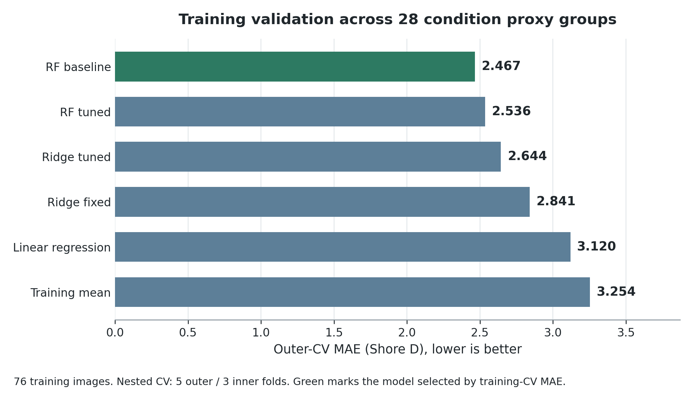
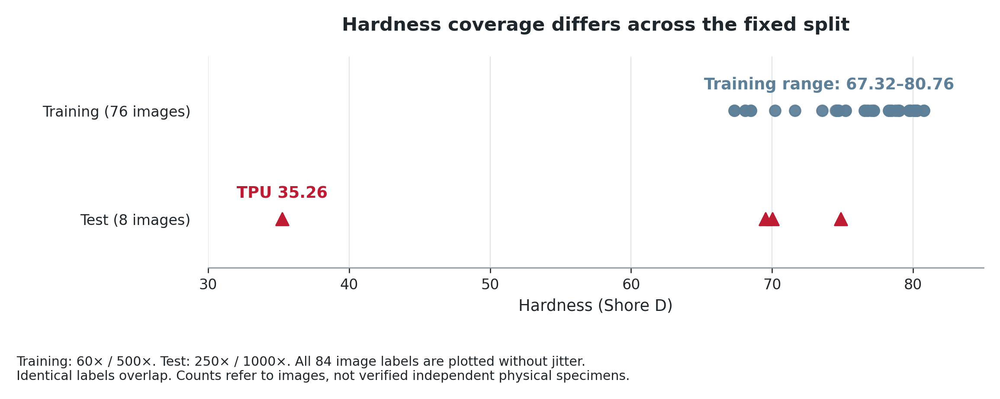

# Person 3: baseline optimization and evaluation

This extension adds completed baseline training, tuning and evaluation to the original MASC 520 team project. It reproduces fitting from 20 cached SEM image features. It does not re-extract pixels or train a new CNN. Historical CNN predictions are retained separately as context.

## Open or reproduce

Upload [MASC_520_Person3_Completed.ipynb](MASC_520_Person3_Completed.ipynb) to an isolated Google Colab notebook. Actual execution outputs are already saved, so running is optional. The notebook embeds the exact feature CSV with a SHA-256 check and needs no image or CSV upload.

For local work, use Python 3.12.14 and start inside this directory:

~~~bash
cd person3_evaluation
python -m pip install -r requirements.txt
python scripts/check_results.py --check
~~~

**Do not launch from the repository root.** Existing root files named numpy.py, sklearn.py and other packages can shadow installed libraries. Use an isolated Colab upload or a notebook environment launched from person3_evaluation.

The recorded training environment used NumPy 2.3.5, pandas 2.2.3, scikit-learn 1.8.0 and Matplotlib 3.10.8. Requirements pin those versions. Different numerical environments may produce small differences.

Run the notebook to refit models. It writes CSVs and plots under the relative directory person3_completed_results and creates a ZIP beside that directory, without replacing the archived results folder.

The check script verifies saved results without retraining. Run python scripts/check_results.py --write to regenerate diagnostics, or python scripts/make_figures.py to regenerate plots.

## Data and evaluation

The fixed split contains:

- **76 training images** from Told et al. (2022), at 60×/500×, spanning **67.32–80.76 Shore D**.
- **8 test images** from Paári-Molnár et al. (2024), at 250×/1000×, spanning **35.26–74.86 Shore D** and representing four material conditions.

Six new strategies were fitted: training-mean prediction, ordinary linear regression, fixed Ridge, baseline random forest, tuned Ridge and tuned random forest. Features follow the original grayscale, half-resolution and 256×256 hand-crafted recipe.

Nested validation uses five outer and three inner folds across **28 training condition groups**, defined by source, material, treatment and treatment cycles. Groups remain disjoint within each split. Scaling, magnification encoding and parameter selection use training folds only. Random-forest search samples six parameter combinations. Selection uses image-weighted outer-CV MAE. Condition-balanced CV MAE is also reported.

## Main results

Display scores are rounded. CSVs retain full precision.

| Model | Grouped-CV MAE | Test MAE | Test RMSE | Test R² |
|---|---:|---:|---:|---:|
| Training mean | 3.254 | 13.675 | 20.910 | −0.747 |
| Linear regression | 3.120 | 15.076 | 20.192 | −0.629 |
| Ridge fixed | 2.841 | 14.425 | 20.606 | −0.697 |
| **RF baseline** | **2.467** | 13.948 | 21.257 | −0.806 |
| Ridge tuned | 2.644 | 14.384 | 20.991 | −0.761 |
| RF tuned | 2.536 | 14.022 | 21.333 | −0.819 |
| CNN historical | Not run | 13.672 | 20.445 | −0.670 |

RF baseline was selected using training-CV MAE. Ridge tuning reduced CV MAE by **6.91%**, while RF tuning increased it by **2.82%**. Held-out improvements were inconsistent. Ridge test MAE improved slightly, but RMSE worsened. Tuned RF worsened both test error metrics.

Historical CNN MAE was **13.671750**, almost identical to the fitted training-mean benchmark's **13.674737**. Linear regression had the lowest test RMSE, so there is no single winner across metrics.

Negative test R² means squared error exceeds the reference predicting the **test target mean** for every image. It does not automatically imply worse performance than the separately fitted training-mean benchmark.

## Limitations and diagnostics

- Condition groups are proxies, not verified physical-specimen IDs. Eight images are not evidence of eight independent specimens.
- The test set was previously examined. This is retrospective cross-study evaluation, not a new blind test.
- Study source, composition, magnification and target coverage change together. Their separate effects were not isolated.
- Both unseen test magnifications map to all-zero training-fitted one-hot codes. This is the specified unknown-category handling, with an unquantified separate effect.
- Current standard forests cannot predict below the training minimum, 67.32. Two TPU targets at 35.26 alone imply SSE ≥ 2055.6872, versus test SST = 2001.7472. Even perfect predictions on the other six images leave **R² ≤ approximately −0.02695**. This bound does not apply to Ridge or CNN.
- CNN predictions are historical values rounded to three decimals. CNN was not retrained or nested-cross-validated here, and its preprocessing differed.
- Raw image hashes and features were supplied by extraction and were not independently recomputed here. No statistical-significance or reliable-generalization claim is made.

See [diagnostic explanations](docs/DIAGNOSTICS.md).

## Files

| Location | Purpose |
|---|---|
| MASC_520_Person3_Completed.ipynb | Self-contained executed analysis |
| data/MASC_520_Person3_Features.csv | Cached features, labels and extraction metadata |
| data/labels.csv | Reference label and condition metadata |
| results/ | Metrics, predictions, folds, protocol, selection and diagnostics |
| results/original_model_predictions.csv | Original teammate predictions, distinct from new baselines |
| figures/ | PNG and vector PDF figures, including original-model comparison |
| scripts/ | Verification, diagnostics and plot regeneration |
| protocol/prespecified_training_logic.py | Reference functions, not a standalone entry point |

The poster is a separate deliverable and is not included here.

## Sources

Told et al. (2022), Materials & Design, 223, 111119. [Paper DOI](https://doi.org/10.1016/j.matdes.2022.111119).

Paári-Molnár et al. (2024), dataset of the comprehensive study of conductive polymer composites for medical applications through additive manufacturing. Mendeley Data, V3: [dataset DOI](https://doi.org/10.17632/6hgh5zrny5.3).
